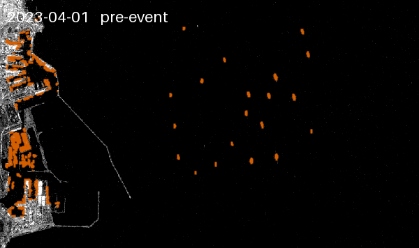

# Monitoring Ship Anchorage at Constanța Port Using Sentinel-1

**Geoscripting project · WUR · 2026**
- **Team:** Luca Tarchila, Paulian Oprescu, Phuong Nguyen, Ravian Hendriks
- **Challenge:** own

We count vessels in the port and offshore anchorage of Constanța (Romania) on Sentinel-1 radar images from 2019 to 2025, using Google Earth Engine. Ships have a much higher radar backscatter than calm sea water, so a simple dB threshold separates them. We compare the counts with IMF PortWatch port calls to see whether our detection captures the change in vessel traffic during the war in the Black Sea region.



## Research questions
1. Can we build a simple vessel detection algorithm based on a backscatter (dB) threshold that separates ships from the dark sea water?
2. Does our detection algorithm capture the trend in vessel traffic at Constanța, as recorded by IMF PortWatch, during the conflict in the Black Sea region?

## How to run
1. Clone the repository and install the environment:
```bash
   pixi install
```
2. Open `main.ipynb` and select the **Python (Pixi: default)** kernel.
3. In section 1.4, replace `gee_project` with your own Google Earth Engine project ID.
4. Run all cells. Counting ships in all scenes (section 6) takes a few minutes.

To analyse another port, create a new `Port` instance in the Settings cell (see section 2 of the notebook).

## Repository structure
```
main.ipynb               # the full analysis
functions/detection.py   # Port class: water mask, Sentinel-1 loading, ship detection, timelapse
functions/plots.py       # PortWatch download and comparison plots
masks/                   # OSM water polygons
data/                    # ship counts and PortWatch data (created when running)
output/                  # timelapse GIF (created when running)
```

## Data
- **Sentinel-1 GRD:** ESA Copernicus, via Google Earth Engine (`COPERNICUS/S1_GRD`). https://developers.google.com/earth-engine/datasets/catalog/COPERNICUS_S1_GRD
- **Water polygons:** OpenStreetMap. https://osmdata.openstreetmap.de/data/water-polygons.html
- **Daily port calls:** IMF PortWatch (port260, Constanța). https://portwatch.imf.org/pages/data-and-methodology

## License
MIT, see `LICENSE`.

## Use of AI
We used Claude (Anthropic) to improve the wording and grammar of the markdown text. Where AI was used for help with the code, a link to the chat log is included in the code comments of the relevant function.